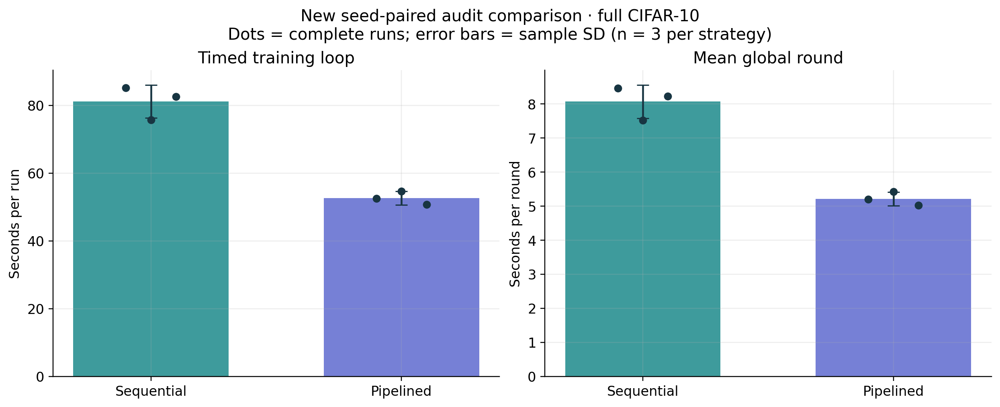
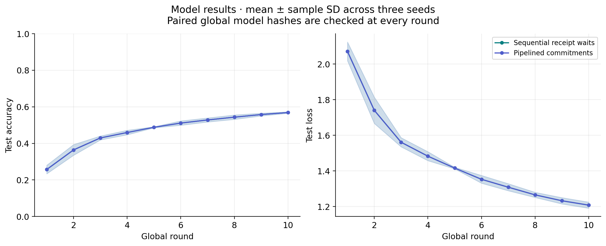

# Optimization appendix: readiness, task coordination and pipelined audit submissions

**Status:** Measured implementation draft, 2026-10-29. This appendix describes the new optimization cohort. The original `report.md`, `analysis.json`, source manifest and `figures/` remain the v1 record. Numerical results below use only the six explicitly selected new full-data runs; old v1 timings and smoke runs are excluded from the new comparison.

## Implemented changes

Network readiness now checks four owned validator processes before accepting RPC observations. It checks chain ID, agreement on the genesis hash and the expected QBFT validator set, then requires all four observed block heights to advance beyond a fresh baseline. A responding endpoint with a stored height alone cannot pass this check. The checks are in `network/manage.py` and their regression cases in `tests/test_network_ready.py`. This establishes the implemented local readiness conditions; it does not constitute a proof of Byzantine behavior under arbitrary faults.

Mutating entry points share an OS file lock, including training, batches, network management, contract writes and fault experiments. The JSON sidecar communicates owner information; it does not determine lock ownership. The scheduler retains its lease for the entire comparison and delegates only to its verified descendant processes. The UI displays busy state and relies on the child process's authoritative lock acquisition. The lock is released by the OS after owner termination. The process-tree cleanup accounts for the Windows virtual-environment redirector. See `common/job_lock.py` and `common/processes.py`.

The default `sync` audit strategy is retained. Under `pipelined`, a client trains, signs and sends its own update, then the coordinator can train the next client without waiting for that receipt. After all four sends, all four successful receipts are required; all four actual model files are reloaded and independently checked against live contract readbacks before FedAvg is allowed. Aggregation is then committed as before. GPU training itself remains sequential. A failed send, receipt, file check or chain readback prevents aggregation. Prepared signed transaction hashes and submission/confirmation failures are retained for diagnosis; this iteration does not implement full automatic interrupted-run recovery.

## New comparison design and validation

The cohort is `audit-optimization-20261029-final` with exactly `sync` and `pipelined` for seeds 42, 43 and 44. Each run uses all 50,000 CIFAR-10 training images and 10,000 test images, ten rounds, four logical clients, and one local epoch. The paired training conditions, initialization and data-index hashes agree. The fixed scheduler seed is 2027; the saved order is s42:pipelined → s42:sync → s43:sync → s43:pipelined → s44:pipelined → s44:sync. A complete run is the replicate. The analysis is descriptive, with sample SD across three runs per strategy; no significance or broad performance guarantee is asserted.

A separate initial engineering preflight attempt was retained at `../results/audit-optimization-20261029-pipelined-s42/` and failed the readiness gate with `RuntimeError: Node 1 returned an invalid QBFT validator list`. It did not reach the training-result stage and is excluded from the six completed runs rather than silently merged or replaced in their statistics. The new cohort uses its own explicit `-final` schedule.

The analysis independently checked **300 saved models** against successful decoded `UpdateCommitted` and `AggregateCommitted` events and deterministic file commitments. The **366 receipts** comprise 61 successful application transactions per run: one run creation, ten round openings, 40 update commitments and ten aggregate commitments. Transaction counts, identities, run keys, receipt hashes and local/live readback agreement are checked in `analyze_optimization.py`. All ten corresponding aggregate-model hashes, initial hashes and data-index hashes match for every seed pair. These checks validate the saved evidence and deterministic outcome of the selected runs, not the honesty of arbitrary training or the correctness of every future aggregation.

The retained unit-test log reports **46 passed, 3 warnings in 11.54s** (`../results/optimization-unit-tests.txt`). The recorded mutual-exclusion integration check passed for 8 mutation entry points, with the validator network still ready. See `../results/optimization-conflict-checks/validation.json`. The retained real-chain contract regression completed with 19 successful checks (`../results/contract-tests-f665295258/checks.json`); its negative transactions are outside this performance cohort.

Read-only Streamlit AppTest checks passed for all four pages, the pipelined selector and the explicit six-run study filter. The complete tenth-round pipelined model also matched a live `eth_call` commitment at block 4014. The evidence is `optimization_ui_validation.json`; no training launch or signed transaction was requested by that check.

## Measured results

| Strategy | Runs | Final accuracy, % (mean ± SD) | Training-loop seconds (mean ± SD) | Mean round seconds (mean ± SD) | Application audit tx/s (mean ± SD) |
|---|---:|---:|---:|---:|---:|
| Sequential receipt waits | 3 | 56.87 ± 0.41 | 81.15 ± 4.88 | 8.070 ± 0.490 | 0.692 ± 0.039 |
| Pipelined commitments | 3 | 56.87 ± 0.41 | 52.63 ± 1.98 | 5.211 ± 0.200 | 1.018 ± 0.041 |

| Seed | Sync loop seconds | Pipelined loop seconds | Saved seconds | Saved % |
|---|---:|---:|---:|---:|
| 42 | 85.146 | 52.504 | 32.642 | 38.34 |
| 43 | 75.707 | 54.670 | 21.037 | 27.79 |
| 44 | 82.593 | 50.724 | 31.869 | 38.59 |

Mean paired saving was **28.52 ± 6.49 seconds**. The ratio of mean pipelined to mean synchronous loop time was **0.6486**, or **35.14% less timed loop duration** in this local experiment. The corresponding final model hashes matched, so the measured timing difference was obtained without changing those paired model parameters. This is a measured result for the retained conditions, not an a priori guarantee for a different network, model or machine.

*Figure 1. Only the new six full-data runs. Each point is one complete run. Error bars are sample SD across three seeds per strategy. The timed training loop excludes network startup, initial dataset preparation and run creation; these remain separately recorded in the per-run summaries.*

*Figure 2. Mean and sample SD of test accuracy and loss. The paired curves overlap when the model hashes match. This does not establish statistical equivalence for untested configurations.*

## Timing boundaries and limitations

`confirmation_seconds` is explicitly a **send-to-first-observed-receipt interval**, including local training and scheduler delay in pipelined mode. A transaction may have finalized before the coordinator asks for its receipt. Therefore that field is not the exact physical finality delay, and comparing it as if it measured a change in consensus speed would be misleading. It is retained as an application-observation metric. Application tx/s uses the first submission to the last observed receipt window, including run creation and preparation gaps; it is not saturated blockchain TPS.

The complete workflow wall time includes orchestration and preparation; its mean ± SD was 92.02 ± 4.90 seconds for sync and 63.62 ± 2.51 seconds for pipelined. The two strategies each retain the same 61 audit transactions per run and the same model-payload byte counts. This optimization overlaps waiting with useful local work and permits multiple pending identities; it does not reduce the audit contract's required participants or suppress successful receipt/hash verification.

The four FL clients still share one process and GPU. Validators are native local processes. The host is not an isolated performance-test machine, and the shared ledger accumulates history across runs; empty blocks, database maintenance and other host activity can affect timing and storage. Three paired seeds give a descriptive variability estimate. Independent FL processes, non-IID/client-dropout experiments and full transaction/run recovery remain future work, outside this iteration's three approved changes.

After the timing cohort, the public `run_training` function received the same outer job guard already used by the experiment entry point. This guard executes before the training-loop clocks. No model algorithm or timed training loop was changed between the six selected runs. The provenance ledger records the final packaged source, including that additional entry-point protection.

## Rebuild and provenance

From the project root, run `.venv/Scripts/python.exe report/analyze_optimization.py`. It refuses missing, incomplete or inconsistent evidence and writes only this optimization appendix, `optimization_analysis.json`, `optimization_provenance.json`, CSV tables and `optimization_figures/`. It never trains or sends a signed transaction. The provenance ledger includes the explicit selection, input hashes, model file hashes and analysis-source hash. Figure exports are PNG and PDF. The original v1 report and figures are unchanged.

Scientific interpretation and final submission remain subject to the named authors' review. Development-assistance procedures are documented in the original report; this appendix adds no new claim of human source verification.
