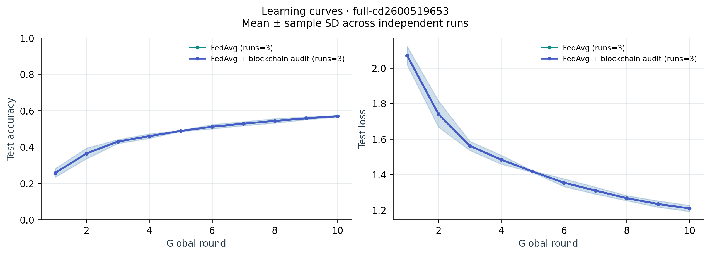
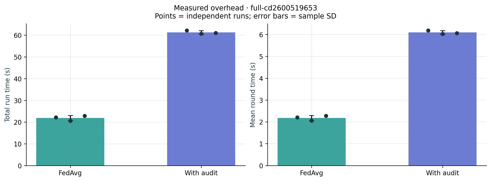
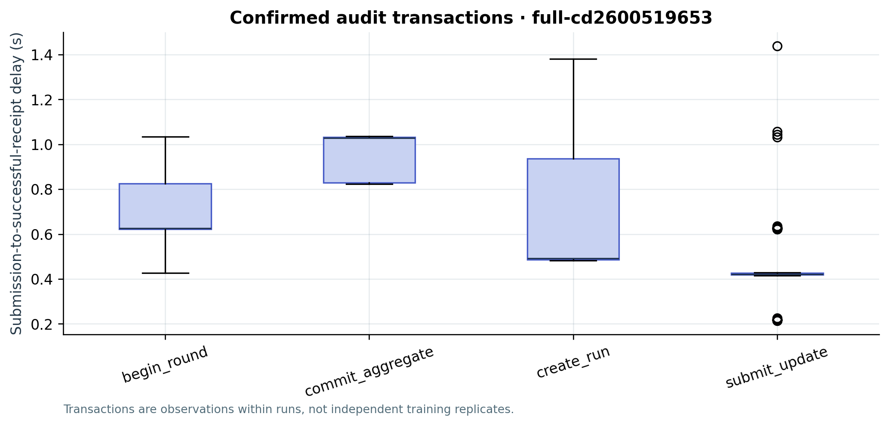
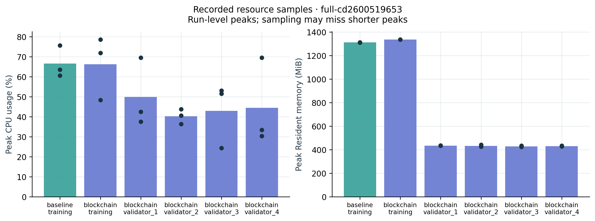

# Blockchain-Enabled Federated Learning: A Consortium Audit Prototype

**Authors:** Shen Xianglu, Zhu Tangyun, Zhang Xu, Zhu Fengjiang, Cai Yicheng, Wang Qiancheng.

**Document status:** Implementation draft with measured results, prepared on 29 October 2026. Main results use the six completed full-data runs identified below. The named authors and source interpretations require human review before submission. The evidence map and agent-checked bibliography are retained in [evidence_map.md](evidence_map.md) and [source_manifest.json](source_manifest.json).

## 1. Introduction

Collaborative learning can leave training data with its owners while combining locally computed model updates. Iterative model averaging is an established approach to this setting [8]. Blockchain-enabled federated learning adds a replicated coordination or recording mechanism; BlockFL is an early example that also analyzes the contribution of computation, communication, and consensus delay [1]. These ideas motivate measuring what a ledger contributes beyond an ordinary training loop.

This project implements a consortium audit prototype for image classification. Four logical organizations hold distinct CIFAR-10 index partitions. Four Flower `NumPyClient` objects train local PyTorch models sequentially in one process, and an in-process coordinator calls Flower's sample-weighted `FedAvg` strategy. Four separate native Besu processes provide the QBFT ledger. The ledger records participant identities, round numbers, local-update commitments, and aggregate commitments; tensor data remain in local off-chain artifacts. This arrangement allows an inspectable course demonstration while keeping its deployment scope explicit. [M01–M04]

The research question is: **What audit evidence does the ledger add relative to ordinary FedAvg, and what latency, storage, and computation overhead does it introduce?** The audit-enabled and audit-disabled modes use the same model and aggregation code. The prototype preserves a central aggregation role. It does not implement a serverless training protocol, separate institutional security domains, or a wide-area deployment. Its contributions are the executable audit state machine, traceable model artifacts, and a reproducible comparison procedure. Whether these benefits justify their measured cost is an empirical question addressed by the main experiment.

## 2. Background and Motivation

In a centralized data-pooling arrangement, the common operator receives the training records. Federated learning instead aggregates local computations, reducing the need to move those records to a shared training location [8]. That change does not by itself determine who may submit an update, how the update is attributed, or which sequence of accepted artifacts another participant can later inspect. The present prototype addresses this recording problem without assuming that an accepted update is scientifically or statistically valid.

Earlier studies examine blockchain/federated-learning combinations in autonomous vehicles [2], industrial IoT [3], and fog computing [4]. Those application domains establish the breadth of the research question; their titles and bibliographic records do not establish that the present prototype reproduces their methods or achieves their reported properties. The survey by Nguyen et al. identifies communication cost, resource allocation, incentives, security, and privacy as central design topics [5]. The present experiment isolates synchronous audit recording, rather than reproducing all of those mechanisms.

Four issues bound that scope. First, non-IID ownership can change the learning problem; the implemented main experiment uses a fixed random partition. Second, requiring every client to submit creates a round-availability dependency when a client drops out. Third, an authorized participant can commit a poisoned or fabricated update. Fourth, sharing updates can still expose information about local training data. These are remaining risks to discuss, not protections inferred from the use of a blockchain. The corresponding implementation assumptions and untested cases are listed in Section 3.4. [M01–M04]

## 3. Proposed Solution

### 3.1. Consortium Governance and Consensus

Known participant identities motivate consortium governance: organizations would agree on admission and a validator set, without requiring open public-chain admission or a single-organization ledger operator. The prototype represents this design with four permissioned Besu validators and a distinct contract-level participant allowlist. All keys and processes are operated on the same host for the experiment, so shared organizational governance is an architectural interpretation rather than a demonstrated institutional arrangement. [M03–M04]

Byzantine state-machine replication supplies the fault-tolerance rationale [6]. For this four-validator QBFT configuration, finalization requires three validators; the protocol can tolerate one Byzantine validator under its cryptographic and communication assumptions. Progress requires sufficiently timely communication. The stopped-node experiment tests a narrower crash/unavailability condition. QBFT does not inspect whether a committed model update was honestly trained. The actual protocol configuration is supported by the Besu documentation [9] and retained genesis file. [M03]

### 3.2. CAP Interpretation and Read Semantics

The CAP result concerns the impossibility of guaranteeing both the specified consistency and availability properties through partitions in the asynchronous service model [7]. Applied to this design, the quorum rule means that a 2–2 partition cannot finalize new writes. A connected component of three validators can progress in a 3–1 partition once communication is timely. These component-size consequences are an analysis of the selected quorum, not a claim that a network-partition experiment was executed. The ledger preserves a single finalized history by accepting loss of write availability when the quorum is unavailable.

This interpretation does not certify every RPC read as current or linearizable. A reachable node may lag. The dashboard's live check records the block number used for its `eth_call`, and the client checks the configured chain ID, contract code, and run identity before reading a commitment. Even that read is a snapshot from the chosen RPC node. Demonstrating the latest common state across all replicas would require additional read-consistency checks. [M05]

### 3.3. Network Architecture and Off-Chain/On-Chain Workflow

1. Initialize a run and authorize its four training participants.
2. Open the next round and wait for the successful transaction receipt.
3. Train each client locally on its assigned partition.
4. Deterministically serialize each update, calculate its hash, submit its commitment under the client's identity, and retain the successful receipt.
5. Check the received off-chain artifact against the recorded commitment before aggregation.
6. Perform sample-weighted FedAvg, save the global model, and commit its hash.
7. Evaluate the global model and repeat the workflow for the next round.

The two four-node sets have different roles: four logical training clients compute updates, while four validators replicate accepted Ethereum transactions. The coordinator sends signed audit transactions through local JSON-RPC. Each training client uses its own participant signing account. The coordinator/administrator account creates a run, opens a round, and commits an aggregate. Per run, the normal application transaction count is one `create_run` transaction plus six transactions per completed round: one round opening, four local submissions, and one aggregate commitment. Thus ten successful rounds would yield 61 successful application transactions, subject to direct verification from the experiment receipts. Contract deployment and negative/failure tests are separate evidence categories. [M04]

Saved data indices, models, manifests, configuration, and receipts link results to the actual inputs. The commitment format `fl-weights-sha256-v1` applies SHA-256 to a domain separator followed by length-prefixed canonical metadata and array bytes. Parameter keys are sorted; metadata include names, shapes, and dtypes; arrays use little-endian contiguous bytes. This commitment is distinct from a checksum of an NPZ ZIP container. Malformed, non-finite, or object-typed parameter arrays are rejected by the artifact loader. [M02]

**Actual deployment.** The four training clients and the coordinator execute sequentially within one Python process and share one CUDA device. Flower supplies the actual client interface and aggregation strategy; this implementation does not start a gRPC server, SuperLink, Ray simulation, or four independent training processes. The four Besu validators execute as independent native JVM processes on Windows, with a shared genesis and separate node directories/keys. The nominal block period is 1 second, the initial request timeout is 4 seconds, the epoch length is 30,000 blocks, and the chain ID is 1337. Zero-base-fee/free-gas settings are used for the private demonstration. These values are configuration inputs, not measured latency guarantees. [M01, M03]

Native processes replace the proposal's intended Docker Compose route because Docker/WSL was not ready on this host. The portable JDK and Besu archives are version-pinned with official SHA-256 values in `network/runtime.json`; the recorded download transport includes a mirror. This deployment change preserves four real QBFT validators but changes environment reproducibility requirements. The report therefore supplies native startup commands and does not claim that a containerized run was measured. [M03]

### 3.4. Threat Model, Privacy, and Trust Boundaries

The relevant assets are accepted commitment history, attribution of submissions, correspondence between saved artifacts and commitments, and training-round availability. The threat model includes an unauthorized account attempting submission, an authorized account submitting twice or for the wrong round, a saved artifact being modified after commitment, and one or two validators stopping. The contract state machine addresses admission, round membership/order, nonzero digests, uniqueness, and the requirement that all four submissions precede the aggregate commitment. `AccessControl` is imported from OpenZeppelin [12]. Rejected transitions preserve the previously accepted state. [M04]

| Actor or failure | Implemented control | Remaining assumption or risk |
|---|---|---|
| Unknown transaction sender | Participant and aggregator roles; per-run participant membership | Account/key administration is trusted |
| Duplicate or wrong-round submission | Active-round and uniqueness checks | A legitimate but malicious first submission can still be accepted |
| Modified off-chain model file | Re-read the file and compare its canonical hash with the recorded commitment before aggregation | Availability and access control of the local artifact store are outside ledger consensus |
| Malicious training participant | Identity and submitted digest remain attributable | No poisoning, honest-training, or gradient-leakage defense is implemented |
| Incorrect or unavailable aggregator | Input artifacts and final commitment are retained for later inspection | Correct FedAvg execution and service availability remain trusted |
| Stopped validator | Four-validator QBFT quorum | Shared-host failures and adversarial validator behavior are not exhaustively tested |

The same Windows user can access all logical datasets and demonstration keys. Dataset ownership is therefore simulated by disjoint indices, not enforced by operating-system isolation. The prototype does not make a production key-management claim. Local node permissioning and contract roles are separate: a party's access to RPC does not grant a training role, and a training role does not make that party a validator. [M01, M03–M04]

The protections rely on the selected hash and signature primitives and the assumed validator fault bound. A content commitment cannot prove dataset provenance, honest optimization, correct aggregation, or privacy. The current round policy also waits for all four clients and has no timeout/skip/recovery policy for training-client dropout. Secure aggregation, differential privacy, poisoning defenses, and zero-knowledge verification remain extensions, rather than measured properties of this implementation.

### 3.5. Transaction Rate, Round Time, Storage, and Resources

The two main throughput measures have different units. Training throughput concerns rounds or examples per unit of training-loop time. Application audit rate counts successful run-creation, round-opening, local-update, and aggregate transactions divided by the interval from the first recorded submission until the final recorded receipt. This window includes the data-preparation gap after run creation as well as model computation between transactions. It is not a saturated-chain benchmark. Deployment, negative tests, and the validator-failure experiment are excluded from the main application count. The rate is derived by `experiments.metrics.transaction_metrics`, and final summaries are refreshed using that common definition. [M06]

`round_seconds` spans round opening, all sequential local updates, artifact processing and readback, aggregation, aggregate commitment, and evaluation. `train_seconds` sums local batch-training intervals, `audit_seconds` includes the audit hooks, and aggregation/evaluation are also separately recorded. GPU synchronization occurs at timing boundaries. Transaction confirmation delay is the wall-clock interval from `send_raw_transaction` submission to an available receipt, including receipt polling; the actual wait mechanism is recorded in the code. The training-loop total and the broader workflow wall time have different boundaries and are reported separately. [M01, M04, M06]

Model byte counts are the uncompressed NPZ parameter payload that would be sent in each direction. They include NPZ container metadata and do not measure network protocol headers or physical communication. Ledger growth is the start/end sum of logical validator file lengths excluding log files; it includes replication and empty-block/background effects and can fluctuate with database behavior. CPU and resident-memory use are sampled every 0.5 seconds for the training process and each validator during `run_training`, including its data preparation and warm-up but excluding validator startup and run creation. Per-process CPU percentages can exceed 100% on multicore execution; summed resident memory may count shared pages more than once. A 32-byte digest is only one payload field, not the entire ledger cost. [M02, M06]

## 4. Demonstration and Experiments

### 4.1. Reproducibility Record

| Item | Actual value / evidence |
|---|---|
| Experiment date and timezone | 29 October 2026; timestamps retained per run, user timezone Asia/Shanghai |
| OS and deployment arrangement | Windows; one Python process with four logical clients; four native Besu JVM processes |
| CPU, available RAM, GPU | Hardware inventory: 8 physical/16 logical CPU cores; approximately 32 GiB installed RAM; RTX 3070 Laptop GPU, 8 GiB VRAM. Available resources vary during execution |
| Python / PyTorch / torchvision / Flower | Python 3.12.7; torch 2.7.1+cu128; torchvision 0.22.1+cu128; flwr 1.19.0 |
| Besu / JDK | Besu 26.10.2; Eclipse Temurin JDK 25.0.5+8, as recorded in runtime manifest |
| Compiler / OpenZeppelin | solc 0.8.24; optimizer enabled, 200 runs; EVM target Paris; OpenZeppelin Contracts 5.4.0 |
| Other direct packages | Web3.py 7.12.0; Streamlit 1.45.1; NumPy 2.1.2; Matplotlib 3.10.1; psutil 7.0.0 |
| Upstream source commits and license notices | `THIRD_PARTY_NOTICES.md` |
| Dataset and train/test indices | CIFAR-10; per-run `data_indices.json` and its SHA-256 |
| Model and optimizer configuration | SmallCNN; SGD, learning rate 0.02, momentum 0.9; batch size 128; per-run config is authoritative |
| Client count, global rounds, local epochs | Four; ten global rounds and one local epoch in all six main runs |
| Experiment schedule and seeds | Training seeds 42/43/44; partition seed 2026; mode-order seed 2026; `results/full-study-20261029-schedule.json` |

### 4.2. Baseline and Integrated Procedure

CIFAR-10 is loaded through torchvision, including its source-batch integrity checks [13]. The archive was obtained from the mirror identified in each run's `dataset_source` record and checked against the official archive MD5 `c58f30108f718f92721af3b95e74349a`. A NumPy permutation with partition seed 2026 fixes four disjoint random client index sets, independently of the training seed. The full-data configuration uses the original 50,000 training images and 10,000 test images; a subset configuration is explicitly tagged and reported separately. Images are normalized from unsigned bytes to the interval [-1, 1] per batch. There is no augmentation. The test set is used for evaluation and is not included in local optimization. [M01]

`SmallCNN` uses two 5×5 convolutional layers with 6 and 16 output channels, ReLU and 2×2 max pooling, followed by fully connected layers of sizes 400→120→84→10. Each local fit constructs SGD with learning rate 0.02 and momentum 0.9; optimizer momentum is reinitialized at every local fit. All clients participate in every round. Local shuffle and initialization use the derived seed `training_seed + 1000 × round + client_id`. Training has two CPU threads, zero DataLoader worker processes, deterministic algorithm selection, fixed cuDNN behavior, and a CUDA workspace setting before device initialization. Per-run configuration and package records remain authoritative if implementation changes. [M01]

The coordinator applies sample-weighted model averaging through Flower 1.19.0 `FedAvg.aggregate_fit` with in-place aggregation disabled. For client sample counts n_i and local model parameters w_i, the aggregate is w = Σ_i(n_i / Σ_j n_j)w_i. A logical client identifier occupies the proxy position because this deployment has no transport layer. Updates and global models are saved as NPZ files and independently loaded before they are used. [M01–M02]

The control mode is FedAvg with auditing disabled; managed runs stop the validator processes for this mode. The treatment mode uses the same training implementation with synchronous audit enabled and starts the four validators. Runs within a seed pair share initialization, ownership indices, batch ordering, hyperparameters, client order, and device scheduling. The initial model and data-index hashes are retained and checked before describing runs as paired. A small device operation and dataset preparation precede the training-loop timing boundary; this warm-up does not guarantee that every CUDA kernel or filesystem cache is equally warm. Mode order is randomized by the batch scheduler and retained. [M01, M06]

The main comparison contains three paired seeds and ten rounds with one local epoch, using all 50,000 training and 10,000 test images. The retained order is blockchain→baseline for seed 42, baseline→blockchain for seed 43, and blockchain→baseline for seed 44. Smaller smoke runs support development and integrity testing but are excluded from the six-run performance analysis. Dataset download and cache preparation have their own timing fields. The workflow clock additionally includes orchestration and network management, while the audit setup field covers contract attachment and run creation. The training-loop total excludes those setup stages. [M06, R01]

A complete training run is the independent replicate. Multiple rounds or transactions from one run are repeated observations, not additional independent training runs. Summaries report individual runs, paired differences, means, and sample standard deviations. Three repetitions support a descriptive account of variability; this study does not predeclare a significance claim.

### 4.3. Measured Results

Only directories beginning `full-study-20261029-` are included here: one `baseline` and one `blockchain` directory for each of seeds 42, 43, and 44. All six report completion, ten rounds, 50,000 training images, and 10,000 test images. The source-file hashes, exact values, analysis script, and generated figures are retained in `analysis.json`, `analyze_results.py`, and `figures/source_manifest.json`. Statistics below use sample standard deviations across the three complete runs per mode. [R01–R02]

| Mode | Completed runs | Final accuracy, % (mean ± SD) | Training-loop seconds (mean ± SD) | Mean round seconds (mean ± SD) |
|---|---:|---:|---:|---:|
| FedAvg | 3 | 56.87 ± 0.41 | 21.87 ± 1.16 | 2.178 ± 0.113 |
| FedAvg + audit | 3 | 56.87 ± 0.41 | 61.28 ± 0.80 | 6.093 ± 0.083 |

The final test loss was 1.2081 ± 0.0172 in both modes. For each seed, the data-index hash, initial model hash, and all ten aggregate-model hashes matched between modes. Thus the observed matching accuracy is also supported by equality of the actual paired model artifacts, rather than rounded metrics alone. This is a property of these deterministic runs, not a general equivalence result. The overlapping curves in Figure 1 are therefore expected. [R01–R02]

| Seed | Accuracy in each mode, % | FedAvg loop seconds | Audit loop seconds | Added seconds |
|---|---:|---:|---:|---:|
| 42 | 57.31 | 22.138 | 62.181 | 40.043 |
| 43 | 56.50 | 20.595 | 60.644 | 40.049 |
| 44 | 56.80 | 22.862 | 61.004 | 38.142 |

Mean paired added loop time was 39.41 ± 1.10 seconds. The ratio of the two mean loop times was 2.80, corresponding to a 180.25% increase relative to the baseline mean. Audit hooks occupied 36.06 ± 1.49 seconds per integrated run; the remaining time difference is not assigned to a single mechanism. The broader workflow wall time was 36.85 ± 1.36 seconds for baseline and 77.64 ± 9.50 seconds with audit. These workflow measurements include orchestration and network-management effects excluded from the training-loop figures. [R02]



*Figure 1. Mean test accuracy and loss, with sample SD across three complete runs per mode. The paired curves overlap because every corresponding aggregate model hash matched. Source: per-run `rounds.csv`; analysis: `analyze_results.py`.*



*Figure 2. Training-loop total and within-run mean round time. Dots are complete runs; error bars show sample SD across three runs. The left total excludes network startup, run creation, and data preparation. The total also includes loop bookkeeping outside individual round clocks.*

The integrated runs each produced 61 successful application transactions and no reverted application transactions, for 183 successes in the main comparison. The category counts and pooled observed confirmation intervals are below. The three run-level mean confirmation delays were 0.5942, 0.5828, and 0.5458 seconds (run-level mean ± SD: 0.5743 ± 0.0253 seconds). Across all 183 receipts, the pooled median was 0.4267 seconds, the 95th percentile 1.0340 seconds, and the range 0.2138–1.4389 seconds. Pooled transaction percentiles describe observations within the runs and are not independent-run uncertainty estimates. [R03]

| Operation | Count across 3 integrated runs | Mean confirmation seconds | Median confirmation seconds |
|---|---:|---:|---:|
| Run creation | 3 | 0.7844 | 0.4913 |
| Round opening | 30 | 0.6922 | 0.6254 |
| Local-update commitment | 120 | 0.4488 | 0.4207 |
| Aggregate commitment | 30 | 0.9371 | 1.0286 |

Observed application audit rate was 0.8740 ± 0.0080 successful transactions per second across the three run windows, which lasted approximately 69.39–70.53 seconds. The denominator includes the interval between run creation and later data/model preparation. These numbers quantify this application's load and waiting pattern; they do not estimate the chain's maximum TPS. The sub-second confirmation observations also do not contradict a nominal 1-second block period: a transaction may arrive partway through a block interval. [R02–R03]



*Figure 3. Successful-receipt delay grouped by operation. Boxes span the interquartile range, the center line is the median, and points beyond whiskers show observed outliers. The run-creation group has only three observations.*

Every main run recorded 10,022,480 bytes of upward and 10,022,480 bytes of downward serialized model payload, identical between modes. An individual NPZ update payload occupied 250,562 bytes. These are application-artifact sizes, not transmitted wire bytes. Integrated ledger file growth across all four validators was 1,604,925 ± 47,534 bytes per run (1.531 ± 0.045 MiB); baseline growth was zero with validators stopped. Because empty blocks and database effects are included, the integrated growth cannot be attributed solely to the 32-byte model hashes. [R02]

| Sampled resource scope | Mean of run-level mean CPU percentages ± SD | Mean of run-level peak RSS, MiB ± SD |
|---|---:|---:|
| Baseline training process | 34.74 ± 3.66 | 1310.68 ± 0.16 |
| Audit-mode training process | 17.83 ± 1.50 | 1335.96 ± 0.81 |
| Four validators, summed within each sampling cycle | 14.02 ± 3.29 | 1710.66 ± 7.82 |

CPU values are raw process percentages, not percentages normalized by the host's 16 logical processors. The training process's lower mean CPU percentage in audit mode is measured over a longer interval containing confirmation waits and does not establish reduced training work. Validator RSS is summed within each validated four-role sampling cycle before taking the run-level peak; the maximum observed timestamp spread within a cycle was 16 milliseconds. Shared pages may be counted more than once. RSS excludes device VRAM. The host's other workloads were not isolated or comprehensively measured, so these measurements do not support energy-efficiency claims or an uncontaminated system-wide resource comparison. [R04]



*Figure 4. Per-process sampled peak CPU and RSS. Bars summarize the three run-level peaks and dots show the individual runs. These CPU peaks differ from the mean CPU percentages in the table. The fixed 0.5-second sampler may miss shorter peaks.*

Rebuild this exact six-run report analysis and its figures with:

```text
python report/analyze_results.py
```

`figures/source_manifest.json` records the source hashes and the explicit six-run selection. Configuration groups and subset/full-data scopes are not pooled. Four figures are exported in both PNG and PDF.

### 4.4. Integrity, Access-Control, and Validator-Failure Tests

| Test | Expected observation | Actual outcome and evidence path |
|---|---|---|
| Unauthorized participant | Submission rejected | Passed; `contract-tests-dad4ad1cdc/checks.json` and status-zero receipt |
| Wrong round | Submission rejected | Passed; same test directory, `wrong round` check |
| Duplicate submission | Rejected; existing record preserved | Passed; `duplicate update`, immutability and run/round isolation checks |
| Tampered artifact | Hash mismatch detected | Passed; `smoke-chain-integration/integrity_test.json`, live-chain original match and changed-copy mismatch |
| Stop one of four validators | New transactions can still finalize under timely communication | Passed; new transfer confirmed in 3.8247 seconds at block 110 |
| Stop two of four validators | No new finalization during the declared observation window | Passed; 15-second observation window, height remained 110 and new transfer remained pending |
| Restore validators | Confirm recovery and transaction/height progress | Passed; pending transfer confirmed at block 111; a new transfer subsequently confirmed at block 113 |

The contract suite recorded 19 passed checks, with 24 transaction receipts: nine successful calls and 15 deliberately rejected calls. Beyond the representative cases above, it checked unfinished-round reopening, empty hashes, premature aggregation, unauthorized administration, aggregate/run overwrites, closed-round submission, skipped rounds, duplicate participant lists, and state rollback after rejected creation. The complete check list and individual receipts are retained rather than counting every rejected transaction as an unexpected failure. [R05]

The pending transaction in the two-node-stop test was confirmed 88.53 seconds after submission. That interval includes the outage and observation period; it is not a pure restart latency. The timestamp from the `validators_restarted` snapshot to its confirmation was 65.36 seconds. A fresh transaction after recovery confirmed in 1.2833 seconds. This run shows that recovery was not immediate, consistent with the need to treat timeout/view-change behavior as part of an operational evaluation. It remains one local stop/restart experiment, not a recovery-time distribution. [R06]

The four dashboard pages also passed an AppTest check against the real experiment directory. The hash-calculation button loaded the complete seed-44 tenth-round global-model artifact and queried its commitment with a live read-only `eth_call` at block 568. The file's canonical hash and the contract value both equaled `24fd8ec7b6a7c4071e00b573e879cbcb5312661891f355a960e4bb9a42f4c56d`. A subsequent snapshot found all four node RPCs responsive at height 570. The validation submitted no signed transaction and did not run additional training. [R07]

The final delivery validator independently checked 150 committed model artifacts—40 local updates and ten global models from each of the three integrated runs—against decoded receipt events and counted the 183 successful application transactions. Its recorded `passed` value is true. The unit-test log reports seven passed tests and two dependency deprecation warnings. A separate fresh-output-directory reproduction run completed one audit-enabled round with 512 training and 128 test examples, producing seven successful application transactions. That reproduction is a short same-environment check, excluded from the main performance sample; it is not evidence of a clean-machine installation. [R08–R09]

Failure tests use a separate experiment run. For node-stop tests, query a running RPC endpoint and retain block heights and receipts before and after the action. Report the observation window and recovery behavior. An RPC timeout to a stopped endpoint alone is not evidence that consensus stalled.

### 4.5. Interpretation and Limitations

The integrated mode added signed attribution and a shared ordered commitment history while retaining exactly matching paired aggregate models in these runs. It imposed a mean additional loop delay of 39.41 seconds for ten rounds, plus the separate setup/orchestration costs. The added records make it possible to inspect which identity committed a particular artifact and to detect changes relative to that artifact's commitment. They do not make the artifact a valid training contribution. Whether this cost is worthwhile depends on the need for independently inspectable records and on the deployment's failure and governance assumptions. [R01–R07]

The single-host design provides no measurement of WAN delay, independent institutional failures, or network transport cost. Sequential clients sharing a GPU eliminate some deployment complexity but also remove parallel-training and straggler effects. The four JVMs have separate state yet share power, storage, memory, and OS scheduling, so their failures are not independent in the operational sense. Dataset partitions are logical rather than process-isolated. [M01, M03]

The selected IID partition and one small CNN constrain conclusions about non-IID convergence or larger models. Three seed pairs are a small descriptive sample; coincident accuracy curves or equal hashes do not establish general statistical equivalence. Fixed deterministic settings support repeatability in this environment, not bitwise portability across arbitrary hardware and package versions. Model payload accounting omits network headers. Startup, warm-up, disk caching, background workloads, receipt polling, and 0.5-second resource sampling can affect timing and peak observations. [M01, M06]

The ledger records what authorized identities committed. It does not validate the optimization process, preserve off-chain availability, make the aggregator highly available, or implement dropout recovery. Signed identity also does not prove the institution or individual who controlled a key. The expected one-fault tolerance is conditional on protocol assumptions; crashing nodes is narrower than malicious behavior. These limits must remain visible when interpreting the measured audit value.

## 5. Conclusion and Future Work

The prototype connects real CIFAR-10 training and Flower FedAvg to a four-validator Besu audit state machine. Six full-data runs completed, contract-access and state-transition checks passed, a changed model artifact was detected, and the observed stopped-validator behavior matched the expected quorum boundary. Across the three paired seeds, initial/data/aggregate hashes matched between modes, final accuracy averaged 56.87%, and synchronous auditing increased the mean ten-round training loop from 21.87 to 61.28 seconds. All values are specific to the stated same-process/native, single-host deployment. [R01–R07]

The intended Docker Compose deployment and independently hosted training clients were not exercised. Non-IID experiments, training-client dropout recovery, deliberate poisoning/gradient-inference attacks, malicious-validator behavior, and actual network partitions were not executed. The corresponding risks are discussed rather than reported as tested protections. Next steps are multi-host deployment with transport measurements, non-IID and dropout experiments, and narrowly evaluated privacy and verifiable-aggregation mechanisms.

## 6. References

1. H. Kim, J. Park, M. Bennis, and S.-L. Kim, “Blockchained On-Device Federated Learning,” *IEEE Communications Letters*, 24(6), 1279–1283, June 2020. [doi:10.1109/LCOMM.2019.2921755](https://doi.org/10.1109/LCOMM.2019.2921755). Author preprint: [arXiv:1808.03949](https://arxiv.org/abs/1808.03949).
2. S. R. Pokhrel and J. Choi, “Federated Learning With Blockchain for Autonomous Vehicles: Analysis and Design Challenges,” *IEEE Transactions on Communications*, 68(8), 4734–4746, August 2020. [doi:10.1109/TCOMM.2020.2990686](https://doi.org/10.1109/TCOMM.2020.2990686).
3. Y. Lu, X. Huang, Y. Dai, S. Maharjan, and Y. Zhang, “Blockchain and Federated Learning for Privacy-Preserved Data Sharing in Industrial IoT,” *IEEE Transactions on Industrial Informatics*, 16(6), 4177–4186, June 2020. [doi:10.1109/TII.2019.2942190](https://doi.org/10.1109/TII.2019.2942190).
4. Y. Qu, L. Gao, T. H. Luan, Y. Xiang, S. Yu, B. Li, and G. Zheng, “Decentralized Privacy Using Blockchain-Enabled Federated Learning in Fog Computing,” *IEEE Internet of Things Journal*, 7(6), 5171–5183, June 2020. [doi:10.1109/JIOT.2020.2977383](https://doi.org/10.1109/JIOT.2020.2977383).
5. D. C. Nguyen, M. Ding, Q.-V. Pham, P. N. Pathirana, L. B. Le, A. Seneviratne, J. Li, D. Niyato, and H. V. Poor, “Federated Learning Meets Blockchain in Edge Computing: Opportunities and Challenges,” *IEEE Internet of Things Journal*, 8(16), 12806–12825, August 2021. [doi:10.1109/JIOT.2021.3072611](https://doi.org/10.1109/JIOT.2021.3072611). Author preprint: [arXiv:2104.01776](https://arxiv.org/abs/2104.01776).
6. M. Castro and B. Liskov, “Practical Byzantine Fault Tolerance,” *Proceedings of the Third Symposium on Operating Systems Design and Implementation*, 173–186, February 1999. [USENIX publication record](https://www.usenix.org/conference/osdi-99/presentation/practical-byzantine-fault-tolerance).
7. S. Gilbert and N. Lynch, “Brewer's Conjecture and the Feasibility of Consistent, Available, Partition-Tolerant Web Services,” *ACM SIGACT News*, 33(2), 51–59, June 2002. [doi:10.1145/564585.564601](https://doi.org/10.1145/564585.564601).
8. B. McMahan, E. Moore, D. Ramage, S. Hampson, and B. Aguera y Arcas, “Communication-Efficient Learning of Deep Networks from Decentralized Data,” *Proceedings of the 20th International Conference on Artificial Intelligence and Statistics*, PMLR 54, 1273–1282, 2017. [PMLR paper record](https://proceedings.mlr.press/v54/mcmahan17a.html).
9. Besu contributors, “Configure QBFT consensus.” [Official documentation](https://docs.besu-eth.org/private-networks/how-to/configure/consensus/qbft), accessed 29 October 2026.
10. Besu contributors, “Create a private network using QBFT.” [Official tutorial](https://docs.besu-eth.org/private-networks/tutorials/qbft), accessed 29 October 2026.
11. Flower Labs, “Quickstart PyTorch.” [Official tutorial](https://flower.ai/docs/framework/tutorial-quickstart-pytorch.html). The implementation pins [Flower v1.19.0](https://github.com/flwrlabs/flower/tree/v1.19.0); current tutorial APIs may differ.
12. OpenZeppelin, “Access Control.” [Official documentation](https://docs.openzeppelin.com/contracts/5.x/access-control); implementation pins [Contracts v5.4.0](https://github.com/OpenZeppelin/openzeppelin-contracts/tree/v5.4.0).
13. A. Krizhevsky, *Learning Multiple Layers of Features from Tiny Images*, 2009. [CIFAR dataset source](https://www.cs.toronto.edu/~kriz/cifar.html).
14. T. Kassis, V. Agarwal, Y. He, D. Patel, and A. M. Brueckner, “Scientific Agent Skills: A Library of Procedural Knowledge for Research Agents,” 2026. [doi:10.48550/arXiv.2609.00065](https://doi.org/10.48550/arXiv.2609.00065).

**Development-assistance note.** Codex assisted implementation, visualization scripts, and report drafting. Local resource, experimental-design, matplotlib, and scientific-writing procedures supported this work [14]. This records the assistance actually used; human review of scientific interpretations, source support, author order, and the final measured report remains pending. The agent-checked evidence ledger does not claim accountable human verification.
